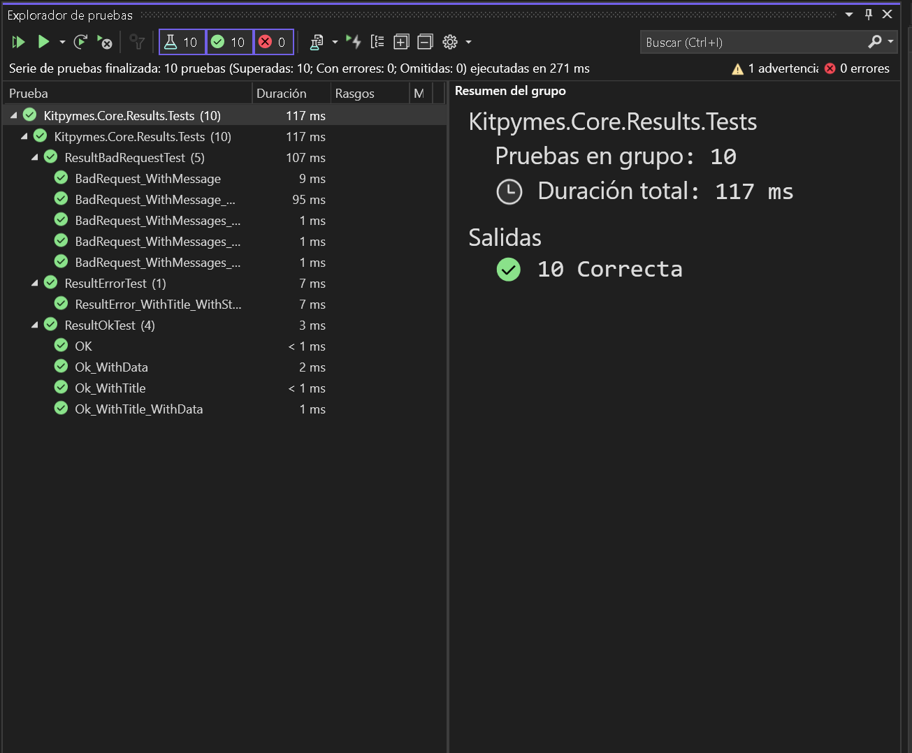

#  Kitpymes.Core.Results

**Resultados estándar: `Result` y `Result<T>` para dominio y aplicación, y `ApiResult` para la API**

[](https://github.com/kitpymes/kitpymes-core-results/actions/workflows/ci.yml)
[](https://www.nuget.org/packages/Kitpymes.Core.Results/)
[](https://www.nuget.org/stats/packages/Kitpymes.Core.Results?groupby=Version)
[](https://github.com/kitpymes/kitpymes-core-results/blob/master/docs/LICENSE.txt)
[](https://github.com/kitpymes/kitpymes-core-results/)
[](https://github.com/kitpymes/kitpymes-core-results/)

## 📋 Requerimientos 

* Visual Studio 2026 o superior

* NET TargetFramework = net10.0

* SDK de .NET = 10.0.x

* C# = 14

* Conocimientos sobre Inyección de Dependencias

## 🔧 Instalación 

_Se puede instalar usando el administrador de paquetes Nuget o CLI dotnet._

_Nuget_

```
Install-Package Kitpymes.Core.Results
```

_CLI dotnet_

```
dotnet add package Kitpymes.Core.Results
```

## ⌨️ Código

### Result y Result&lt;T&gt; (desde la 1.1.0)

Dominio y aplicación devuelven `Result` o `Result<T>`, que no saben nada de HTTP. Los errores de negocio van en el resultado, nunca como excepciones.

```cs
public Result<UserDto> Handle(GetUserQuery query)
{
    var user = _users.Find(query.Id);

    if (user is null)
    {
        return Error.NotFound("Users.NoExiste", "El usuario no existe."); // conversión implícita desde Error
    }

    return Result.Success(new UserDto(user));
}

var result = Handle(query);

if (result.IsFailure)
{
    return result.Error; // Code, Message, Type y Fields (errores por campo)
}

var name = result.Value.Name; // sin la comprobación de arriba, el compilador avisaría al usar Value (CS8602)
```

- **Códigos de error** con la forma `<Modulo>.<Motivo>` (PascalCase, ASCII, sin espacios), por ejemplo `Users.EmailDuplicado`. Son contrato con quien los consume: una vez publicados no se renombran. Las fábricas de `Error` rechazan un código que no siga la forma.
- **Tipos de error:** `Validation`, `NotFound`, `Conflict`, `Unauthorized` (sólo "no identificado"), `Forbidden`, `NotContracted` (módulo no contratado) y `Unexpected`.
- **Errores por campo** sólo en `Error.Validation(code, message, fields)`, cada uno con campo, código y mensaje.
- **No hay conversión implícita desde el valor** (`Result<int> r = 5;` no compila): con nulos, interfaces, `Result<Error>` o `Result<Result>` daría errores o éxitos falsos. Se usa `Result.Success(valor)`.
- **`Result.FailureFor<TResult>(error)`** crea el fallo de un tipo genérico (`Result` o `Result<T>`); lo usa el mediador.
- **`Result.Success(null)` lanza `ArgumentNullException`:** un éxito siempre lleva valor.
- **`Value` lanza `InvalidOperationException`** si el resultado es un fallo. Con tipos de valor (`Result<int>`) el compilador no puede avisar: compruebe `IsSuccess` o use `TryGetValue`.

### Traducción a la API

```cs
ApiResult response = result.ToApiResult();
```

Validation 400, NotFound 404, Conflict 409, Unauthorized 401, Forbidden 403, NotContracted 403, Unexpected 500. Copia `Code`, `Message` y los errores por campo (`FieldErrors` con código y `Errors` por campo); nunca copia excepciones. `ApiResult.Status` es el código que la capa API tiene que poner en la respuesta HTTP: devolver el objeto sin más responde 200.

### KPY0003

El paquete incluye un analizador que da **error de compilación** si se tira un `Result` sin mirarlo, también tras `await` o si es un `Task<Result>` sin esperar:

```cs
await _publisher.PublishAsync(evento);      // KPY0003
var result = await _publisher.PublishAsync(evento); // bien
_ = await _publisher.PublishAsync(evento);  // descarte explícito: bien
```

Para bajar la severidad en un proyecto: `dotnet_diagnostic.KPY0003.severity = warning` en `.editorconfig`.

### ApiResult

```cs
public class ApiResult : IApiResult
{
    public static ApiResult Ok() {}

    public static ApiResult Ok(Action<ResultOptionsOk> options) {}

    public static ApiResult BadRequest(string message) {}

    public static ApiResult BadRequest(string message, object details) {}

    public static ApiResult BadRequest(IEnumerable<string> messages) {}

    public static ApiResult BadRequest(IDictionary<string, IEnumerable<string>> errors) {}

    public static ApiResult BadRequest(IEnumerable<(string fieldName, string message)> errors) {}

    public static ApiResult Error(Action<ResultOptionsError> options) {}

```

## ⚙️ Pruebas Unitarias

_Cada proyecto tiene su test que se ejecutan desde el "Explorador de pruebas"_




## 🛠️ Construido con 

* [NET Core](https://dotnet.microsoft.com/download) - Framework de trabajo
* [C#](https://docs.microsoft.com/es-es/dotnet/csharp/) - Lenguaje de programación
* [Inserción de dependencias](https://docs.microsoft.com/es-es/aspnet/core/fundamentals/dependency-injection?view=aspnetcore-3.0) - Patrón de diseño de software
* [MSTest](https://docs.microsoft.com/es-es/dotnet/core/testing/unit-testing-with-mstest) - Pruebas unitarias
* [Nuget](https://www.nuget.org/) - Manejador de dependencias
* [Visual Studio](https://visualstudio.microsoft.com/) - Entorno de programacion


## ✒️ Autores 

* **Sebastian R Ferrari** - *Trabajo Inicial* - [kitpymes](https://kitpymes.com)


## 📄 Licencia 

* Este proyecto está bajo la Licencia [LICENSE](LICENSE.txt)


## 🎁 Gratitud 

* Este proyecto fue diseñado para compartir, creemos que es la mejor forma de ayudar 📢
* Cada persona que contribuya sera invitada a tomar una 🍺 
* Gracias a todos! 🤓

---
[Kitpymes](https://github.com/kitpymes) 😊